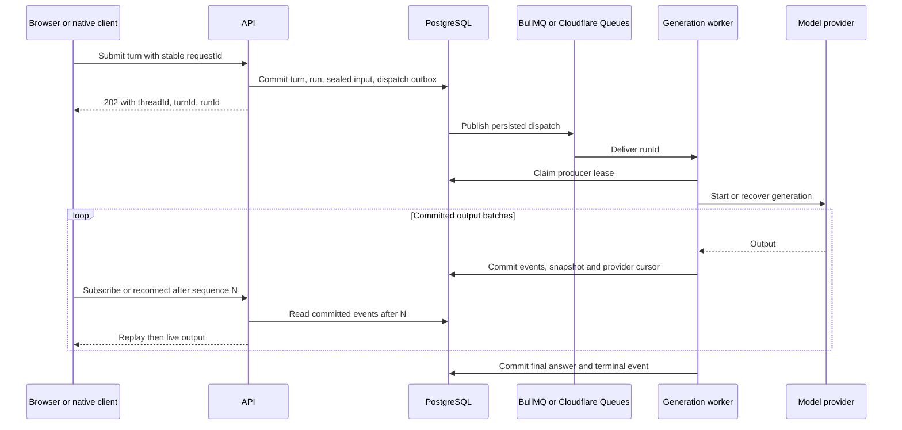

# Ask AI durable streaming implementation plan

Status: implemented locally in six commits, with Cloudflare queue and deployment configuration in two sibling-adapter commits. Production enablement remains gated on a deployed staging smoke test and configured-model background recovery check. Reviewed on October 20, 2026.

Make generation independent of the browser connection, persist output before delivering it, and let any authorized client reconnect to the same run. Use the same application contracts and PostgreSQL records for Node and Cloudflare. Reuse the existing background delivery system: BullMQ on Node and Cloudflare Queues in the serverless deployment.

This extends the existing Ask AI implementation. Keep the existing left AI sidebar, thread rows, composer, citations, attachment acquisition, and presentation modes.

## Required behavior

| Event                                  | Required result                                                                                                                                                        |
| -------------------------------------- | ---------------------------------------------------------------------------------------------------------------------------------------------------------------------- |
| Reload or temporary network loss       | Restore the selected thread, replay committed output, and continue receiving the same generation.                                                                      |
| Close the tab or switch threads        | Generation continues; another tab or device can open it.                                                                                                               |
| Click Stop                             | Persist cancellation for that particular run, stop its producer, and retain the partial answer.                                                                        |
| API server restarts                    | The background worker keeps running; clients reconnect through any healthy API instance.                                                                               |
| Generation worker restarts             | Recover the job and saved output. Resume the same provider response where supported; otherwise preserve the partial answer and expose an interrupted state with Retry. |
| Duplicate submission or queue delivery | Resolve to the same logical turn and prevent concurrent writers.                                                                                                       |
| Access is revoked                      | Stop exposing output and prevent further execution under the revoked access.                                                                                           |

Browser reconnection must not start another model call. Worker recovery must not silently append a new model response to an old partial answer.

## Starting point and reuse

- `apps/server/src/routes/ai/routes.ts` owns the producing HTTP stream. Its cancellation handler aborts generation, and the route has a 180 second deadline.
- `apps/server/src/services/ai/chat.ts` accumulates the answer in memory and writes it on completion or cleanup. It has no incremental output journal.
- `apps/server/src/services/ai/conversations.ts` creates the turn before generation, rejects overlapping turns, and treats old streaming turns as interrupted after a fixed expiry. History reads currently perform that state transition.
- `packages/features/src/ai/stream.ts` consumes the POST response. There is no cursor, subscription endpoint, or explicit remote cancellation operation.
- `chatbot.tsx` aborts its local stream on unmount and thread switches. Selection lives in Query state, so a hard reload cannot reliably identify a previously selected older thread.
- The background foundation already has a PostgreSQL dispatch outbox, leases, renewal, replay, exhaustion handling, and per-runtime adapters. Extend these owners rather than introducing another scheduler.
- Installed AI SDK is `7.0.145`, matching the registry version when reviewed. Its bundled resume guide also separates client disconnect from an explicit server stop. Keep the existing custom client protocol unless a later feature requires migrating the composer to `useChat`. [AI SDK resume guide](https://ai-sdk.dev/docs/ai-sdk-ui/chatbot-resume-streams)

## Cloudflare findings and architecture decision

An ordinary Worker HTTP request cannot provide durable execution after browser disconnect merely by adding `waitUntil()`: the documented extension is up to 30 seconds after the response or disconnect. Cloudflare recommends a separate queue consumer for longer background work. [Workers execution context](https://developers.cloudflare.com/workers/runtime-apis/context/)

Cloudflare Queues provides at least once delivery, so persistence and producer ownership must tolerate repeated messages. A consumer invocation has a 15 minute wall time limit; CPU time is a separate limit. The existing three minute generation budget fits inside that envelope, with time reserved for finalization. [Delivery guarantees](https://developers.cloudflare.com/queues/reference/delivery-guarantees/), [Queues limits](https://developers.cloudflare.com/queues/platform/limits/)

Durable Objects are useful for coordinating subscribers and sending notifications. Their memory and active provider connections still require recovery when objects restart or deployments interrupt them; important state must be written incrementally. An object in front of the existing request stream alone would not establish our persistence contract. [Durable Object lifecycle](https://developers.cloudflare.com/durable-objects/concepts/durable-object-lifecycle/)

Cloudflare's `AIChatAgent` already persists stream chunks, replays output on reconnect, and separates local disconnects from explicit stops. Its current documentation also describes recovery fibers for object eviction. This is a valid alternative if adopting Cloudflare's chat runtime as a product dependency. It would require a deliberate mapping between its SQLite/message lifecycle and Zilobase's PostgreSQL history, authorization, and Node runtime. The recommended first implementation keeps those existing owners and uses the SDK behavior as a reference. [Cloudflare resumable streaming](https://github.com/cloudflare/agents/blob/main/docs/agents/resumable-streaming.md)

Cloudflare Workflows is appropriate when Ask AI expands into multiple durable tool steps, waits, or approvals. Completed step results can be recovered, but retried external calls still need idempotency. Returning a `ReadableStream` from a step does not by itself define our authenticated live subscription or replay protocol. Do not add Cloudflare Workflows or Vercel Workflow SDK for this single generation job. Revisit when orchestration grows. [Workflows rules](https://developers.cloudflare.com/workflows/build/rules-of-workflows/), [Workflow stream output support](https://developers.cloudflare.com/changelog/post/2026-04-21-step-context-and-readable-streams/)

## Shared flow and API

| Proposed endpoint                    | Responsibility                                                                                                                                                                                                                                               |
| ------------------------------------ | ------------------------------------------------------------------------------------------------------------------------------------------------------------------------------------------------------------------------------------------------------------ |
| `POST /ai/turns`                     | Validate and authorize; atomically admit a logical turn, execution attempt, input payload, and dispatch. Return `202` after the transaction commits. Reusing a request ID with the same payload returns the existing IDs; a different payload returns `409`. |
| `GET /ai/requests/:requestId`        | Resolve an authenticated owner's accepted submission when a reload happens before the POST response arrives.                                                                                                                                                 |
| `GET /ai/threads/:id`                | Return saved messages plus any active run, its committed assistant snapshot, and the sequence covered by that snapshot.                                                                                                                                      |
| `GET /ai/runs/:runId/events?after=N` | Return ordered NDJSON event envelopes after the cursor, then tail committed output. Reconnect after transport closure; cap subscriber buffers and connection duration.                                                                                       |
| `POST /ai/runs/:runId/cancel`        | Persist an idempotent cancellation request for this run. A late stop cannot cancel a newer run.                                                                                                                                                              |

Keep `/ai/chat` during migration as a compatibility wrapper over admission plus subscription. Its connection cancellation must detach the subscriber only. Remove the wrapper after supported clients migrate.

Use an envelope such as `{ version: 1, runId, seq, event }`. Retain the existing context, delta, completion, and error semantics, with persisted queued/running/stopped/interrupted states. Bound event sizes and page replay reads. Authentication, owner/workspace checks, and existing source-access rules apply to every read, subscription, and cancel operation.

Start with bounded database tail reads, around every 500 ms while active, released between reads. Batch output at around 100–250 ms or 4 KiB, whichever occurs first. These are initial tuning values. Subscriber count and database load must be measured before general rollout. Later, Node Redis notifications and a Cloudflare Durable Object can wake subscribers after a commit; the database cursor remains authoritative if a notification is missed.

## Persistence and producer ownership

Create a new migration; preserve historical migrations and existing completed turns.

| Record                              | Proposed contents                                                                                                                                                                                                                                                |
| ----------------------------------- | ---------------------------------------------------------------------------------------------------------------------------------------------------------------------------------------------------------------------------------------------------------------- |
| `ask_ai_run`                        | Run/turn IDs, attempt number, state, actor/workspace/cell, model/config identity, lease owner and monotonically increasing fence, lease deadline, cancellation request, last committed sequence, provider response ID/cursor, timestamps and bounded error code. |
| `ask_ai_run_event`                  | Unique `(run_id, seq)`, typed event payload, creation time; provider event identity when available for deduplication.                                                                                                                                            |
| `ask_ai_run_input`                  | Encrypted, bounded, temporary execution payload containing the accepted context and local editor snapshots required after the request ends.                                                                                                                      |
| Existing turn/thread records        | Materialized assistant text and status, active run reference, and thread activity needed by the sidebar.                                                                                                                                                         |
| Existing background dispatch record | `ai.generate` task pointing to the run; no prompts, credentials, or editor documents in queue messages.                                                                                                                                                          |

Enforce one active logical turn per thread with a database constraint or locked admission transaction covering queued and running work. Keep `requestId` as the submission's idempotency identity. Give each execution attempt a separate run ID so a retried generation cannot mix output with its predecessor. An explicit user retry submits a fresh request ID and recaptures context if the temporary execution input has already been removed.

Commit event batches, the materialized assistant snapshot, its sequence, and the provider cursor atomically. Publish only committed batches. On reload, hydrate the snapshot through sequence N, then apply events strictly greater than N; reject duplicates and fetch again on a gap. Once events expire, serve a fresh snapshot with its covered sequence rather than appending an incomplete replay.

Claim and renew a producer lease before calling the model. Fence every output and terminal write by lease owner, fence value, and active state. Abort model consumption immediately when ownership is lost. The existing delivery heartbeat currently notices lost ownership after the handler finishes; extend its handler boundary to signal lease loss during generation. A broker lock alone is insufficient.

Finalize the answer, usage, terminal state, and terminal event in one transaction. Late deltas and late completion callbacks cannot overwrite cancellation or another attempt. Replace history-read expiry mutation with worker/maintenance reconciliation using actual ownership and progress.

## Serverful implementation

Use the existing Node API and background roles, dedicated queue Redis, and PostgreSQL. Run API and background roles in separate production processes so restarting the API does not kill its producer. Add an `ai` lane and `background-ai` queue with independently configurable concurrency. Run the shared AI domain handler from BullMQ, so the API process and subscriber lifecycle do not own generation.

Persist admission and dispatch together using the current background transaction/outbox. Retain task IDs across publication retries. Extend lane mapping, readiness, exhaustion handling, maintenance, replay, and deployment setup. Queue Redis should retain jobs across restarts; PostgreSQL dispatch reconciliation must repair lost or unpublished queue work.

On worker shutdown, stop new claims and allow bounded draining. If terminated, a replacement worker acquires ownership and applies the recovery rules below. BullMQ can redeliver stalled work, so recovery must fence old writers rather than assuming a task runs exactly once. [BullMQ stalled jobs](https://docs.bullmq.io/guide/workers/stalled-jobs)

## Serverless implementation on Cloudflare

Add `AI_RUNS` producer bindings and an AI queue plus dead letter queue to the existing API and background Worker configuration. Use a batch size of one and low batching delay so several model calls do not execute sequentially within one consumer invocation. Give AI its own concurrency budget so generation cannot starve calendar, notification, or database work.

The queue consumer awaits the shared generation handler through its terminal state or a persisted retry decision. It uses its own database scope through Hyperdrive, without carrying the HTTP request, cookie, session token, or request abort signal. The browser's Worker request only reads output.

Keep the first release's bounded provider deadline below the queue invocation limit. Configure CPU limits based on measured context/serialization cost, not the time spent waiting for model tokens. Include dead letter reconciliation and periodic recovery of queued or lease-expired work. Queue messages may repeat and arrive later than publication; admission remains in PostgreSQL.

A future `AiRunNotificationRoom` may broadcast committed sequence hints for a thread. Scope object names by deployment/cell, workspace, owner, and thread. Authorize connections before attaching them. Its sockets and local buffers are an optimization; clearing the object must not erase the conversation or restart generation.

## Recovering the model call

There are two capability levels:

1. **Browser recovery, for every supported provider:** the background producer continues after client disconnect and clients replay committed output. If that producer dies and the provider has no resume capability, retain the saved partial answer and mark it interrupted. Retry creates an explicit new attempt; it does not concatenate another model completion.
2. **Recovery of the same provider response:** add a provider adapter that persists its response ID and acknowledged provider cursor. A replacement worker retrieves or resumes that response and deduplicates provider events before committing application events.

OpenAI's background Responses API supports starting with `background=true` and `stream=true`, then reconnecting with a response ID and `starting_after` sequence. The guide documents temporary provider retention, so recovery must occur within the applicable availability window. Gate this capability on the configured model and project settings; keep the existing model unless its support is verified. [Official OpenAI background mode documentation](https://developers.openai.com/api/docs/guides/background)

The installed AI SDK OpenAI options do not establish a complete background-start/retrieve/resume adapter. Verify the exact transport support in an initial spike; use a small provider-owned REST/SDK adapter if necessary. Save the provider cursor only with the corresponding committed application output. If the create request's result is unknown before a response ID is saved, do not blindly create another paid generation: use verified provider idempotency/reconciliation if available, otherwise expose an ambiguous/interrupted attempt.

This limitation applies equally to queues, Workflows, and Durable Objects. Persisting application state cannot reconstruct an arbitrary lost model connection.

## Client behavior and access

Move submission, resume/reconnect, event reduction, and remote cancellation into `packages/features/src/ai`. Keep the web composer and rendering in their existing owners. Use the existing platform ports for any browser persistence; shared features must not import browser storage.

Put the selected thread in validated route search state for the full AI screen, and share that selection with docked/floating presentations. Persist a minimal, session/workspace-scoped pending submission receipt before POST, containing the request ID and accepted identifiers once known. Resolve that receipt after reload before attempting another submission. It must not contain captured source content or credentials.

Unmount, presentation change, and switching threads close only subscriptions. Update the current switch handler accordingly. Explicit Stop calls the cancel endpoint; it also works from a new device. Sidebar thread rows show queued/running state and remain on the selected conversation while another one finishes.

Background execution reconstructs trusted actor context from server records and rechecks membership, scopes, and resource access. Subscription access is rechecked on connection and on bounded renewal intervals; revocation notifications may close it sooner. Cancellation and deletion fence writers and clean up inputs, events, and pending work. Encrypted temporary input is required to preserve accepted unsynced editor content across a worker restart: define an AI-specific encryption key, maximum payload, and retention policy. Default proposal: remove input at terminal completion, retain abandoned input no longer than one hour, and retain replay events for 24 hours after termination while normal message history follows its existing policy. Never expire a live run without first terminating it.

## Implementation passes and acceptance

| Pass                             | Main owners                                                                   | Acceptance                                                                                                                                                                                                         |
| -------------------------------- | ----------------------------------------------------------------------------- | ------------------------------------------------------------------------------------------------------------------------------------------------------------------------------------------------------------------ |
| 1. Protocol and provider spike   | AI contracts, service tests, provider adapter                                 | Prove disconnect/stop separation, cursor reduction, exact configured-model recovery support, and ambiguous provider-create behavior. Record guarantees before runtime work.                                        |
| 2. Admission and persistence     | AI schema/services, background publication                                    | New migrations, atomic turn/run/outbox admission, idempotent retries, sealed input, fencing, snapshot/event consistency, and cancellation races pass PostgreSQL integration tests.                                 |
| 3. Shared producer and Node      | AI handler, app background processor/failures, runtime ports and Node adapter | Node reload continues one model call; API restart preserves it; worker termination follows recovery policy; duplicate jobs cannot duplicate output.                                                                |
| 4. Cloudflare adapter            | Worker bindings/jobs/background runtime and Cloudflare adapter repository     | Same scenarios pass in Workers tests and a deployed staging smoke test, including consumer termination, delayed delivery, limits, and dead letter handling.                                                        |
| 5. Shared client and existing UI | Features AI, routing and existing sidebar/composer                            | Hard reload, offline/online, multi-tab/device resume, selected older threads, switching presentations, and explicit remote Stop work without duplicate messages.                                                   |
| 6. Controlled rollout            | Deployment configuration, maintenance, telemetry                              | Enable per deployment only after both runtimes meet the same contract. Drain existing request-owned streams before changing behavior; rollback retains readable saved messages and inputs needed by admitted runs. |

Use real Node/Worker streaming transports for reload tests; the deterministic UI fixture alone cannot demonstrate producer durability. Include kill-after-commit, completion-before-reconnect, lost POST response, lease loss with the old process still alive, source revocation, expired event cursors, database/Redis outage, and cancel-before-start tests.

Run shared feature tests, affected server/runtime-adapter tests, web tests, workspace typechecks, lint, formatting, and architecture checks for implementation. Track queue delay, first-token latency, replay latency, active producers, checkpoint writes, subscriber count, stale leases, recovery outcomes, cancellations, and duplicate provider starts. Keep prompts and source documents out of telemetry.

The release gate is observable: reload mid-response on both Node and Cloudflare, restore the same thread and run, continue the answer without duplicate text, and show exactly one admitted generation. Report worker-restart recovery separately for providers with and without response-resume support.

## Implementation verification

Local checks passed: 560 shared-client tests, 598 web checks, 43 focused server tests,
103 runtime-adapter tests, 38 workerd/Miniflare tests, 7 browser checks, workspace
TypeScript checks, lint, formatting, and architecture checks. The sibling Cloudflare
adapter passed its build, 15 configuration/development tests, and 14 workerd tests.
The disposable PostgreSQL/Valkey check applies the real migrations and executes a
queued producer after its subscriber disconnects. It also checks cancellation
before start and during buffering, idempotent admission, source/session revocation,
fencing, a simulated foreground producer loss, recovery from a persisted provider
response/cursor, and snapshot reset after journal compaction. Browser fixtures
exercise reload recovery and explicit remote Stop without asserting real provider
durability. No paid provider requests or production deployment were performed.

Release checks still required in deployed staging: actual process/consumer
termination, provider/model background-response compatibility, cross-instance
reload and network interruption, queue/database outages, and polling load at the
expected subscriber count. Keep durable admission and provider background mode
disabled until these pass; the server README documents keys, migration order,
Node/Cloudflare setup, telemetry, retention, draining, and rollback.
